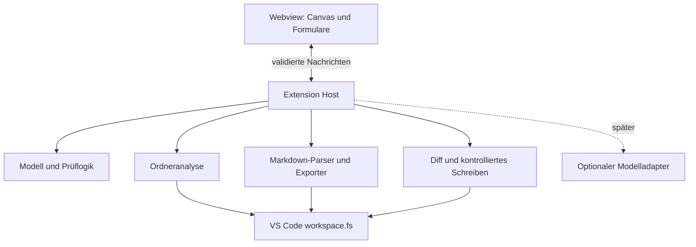

# Produkt- und Umsetzungsplan

Stand: 19. Oktober 2026. Zielarchitektur und Roadmap. Die Implementierung ist gestartet; der tatsächliche Funktions- und Prüfstand steht in [Implementation status](implementation-status.md).

## 1. Ziel und Leitentscheidung

Eine VS-Code-Extension unterstützt Anwender dabei, aus dem aktuellen Projektordner einen nachvollziehbaren KI-Workflow zu gestalten. Sie erklärt, welche Dateien ein Agent für eine Aufgabe lesen soll, welche Werkzeuge er benötigt, welche Schritte er durchführt und wo er Ergebnisse ablegt. Ein Canvas mit verbundenen Nodes macht Reihenfolge und Übergaben sichtbar; ein geführter Editor hilft beim Ausfüllen und weist auf Lücken hin.

ICM verwendet das Dateisystem als Architektur: ein Agent arbeitet nacheinander in unterschiedlichen Rollen, lädt nur den benötigten Kontext und übergibt Ergebnisse als Dateien. Die Extension ist der Editor für diese Architektur. Erzeugte Workflows bleiben ohne Extension lesbar und verwendbar.

Die Grundlage bilden die fünf Kontextebenen und Stage Contracts des offiziellen Repositories. Quellen, der Field-Guide-Abgleich und bewusste Umfangsgrenzen sind in [Quellen und Entscheidungen](sources-and-decisions.md) dokumentiert.

## 2. Zielgruppe und erster Umfang

Zielgruppe sind Personen, die wiederkehrende Recherche-, Schreib-, Analyse-, Entwicklungs- oder Produktionsabläufe mit KI strukturieren möchten, ohne ein Orchestrierungsframework zu programmieren.

### MVP

- Aufruf über Explorer-Kontextmenü „ICM-Workflow für diesen Ordner erstellen“ und Command Palette.
- Ordneranalyse mit sichtbarem Umfang und nachvollziehbaren Vorschlägen für vorhandene Dateien, Referenzen und Tools.
- Zwei Einstiege: **Ordner-Routing** für bestehende Dateien oder **mehrstufiger Workflow** mit nummerierten Stage-Ordnern.
- Geführte Erstellung mit den fünf Field-Guide-Einstiegsfragen, begründeter Mechanismus-Empfehlung, vollständiger Formularansicht und jederzeit speicherbarem Entwurf.
- Node-Canvas mit Anlegen, Verbinden, Umordnen und Entfernen von Stufen; ergänzende bedienbare Listenansicht.
- Stage-Editor für Inputs, Process, Outputs, Tools, Checkpoints und Audits.
- Deterministische Vorschläge und Prüfungen funktionieren ohne KI-Anbieter oder API-Key.
- Vorschau der Markdown-Dateien und Datei-Diffs vor dem Schreiben.
- Speichern, erneutes Öffnen und Bearbeiten unterstützter ICM-Dateien; vorhandene freie Inhalte bleiben erhalten.
- Anzeige vorhandener Ergebnisdateien, ohne daraus eine erfolgreiche Ausführung abzuleiten.

### Später

- Optionaler KI-Assistent über die VS-Code Language Model API, sofern Modell und Nutzungsfreigabe verfügbar sind.
- Zusätzliche Agent-Einstiegsdateien, Vorlagenbibliothek und kontrollierter Import externer Skills.
- Unterstützung umfangreicher bestehender ICM-Workspaces und zusätzlicher Markdown-Dialekte.
- Explizite Laufverwaltung und Agent-Übergabe, falls als eigener Funktionsumfang beauftragt.

### Nicht im MVP

Keine Agentenausführung, Shell-Ausführung, automatische Toolinstallation, Credentials-Verwaltung, Cloud-Orchestrierung, parallelen Agenten, Schleifen oder automatischen bedingten Verzweigungen. n8n ist die visuelle Inspiration. Der erste Workflow-Typ ist eine geordnete Stufenfolge mit zusätzlichen Abhängigkeiten auf frühere Ergebnisse.

## 3. Bedienablauf

1. **Ordner bestimmen:** Kontextmenü-URI hat Vorrang; danach Ordner der aktiven Datei innerhalb eines geöffneten Workspace-Roots; sonst Auswahl aus Workspace-Roots. Ohne passenden Ordner öffnet sich ein Ordnerdialog. Das Terminal-Arbeitsverzeichnis ist kein verlässlicher impliziter Kontext. Bei Multi-Root wird der gewählte Root sichtbar angezeigt.
2. **Bestand prüfen:** Dateibaum, vorhandene `CONTEXT.md`, Agent-Einstiege, Referenzen, Skill-Dateien und Manifeste erfassen. Verzeichnisse wie `.git`, Abhängigkeiten und Build-Ausgaben ausschließen. Inhalte nur bei Bedarf und begrenzt lesen; sensible Dateien wie `.env` standardmäßig ausnehmen. Externe Symlinks nicht verfolgen.
3. **Eignung und Ziel klären:** Die fünf Field-Guide-Fragen zu Wiederholung, editierbaren Artefakten, Übergaben, maßgeblichen Systemen und Grenzen erfassen. Als kleinsten ausreichenden Mechanismus Dateien/Checkliste, Prompt/Skill, ICM, Software oder Hybrid empfehlen und die Begründung anzeigen. Bestehendes Routing bevorzugt erhalten. Wer nur einen Index braucht, kann beim Ordner-Routing bleiben; bei fehlendem ICM-Bedarf muss kein Workflow erzeugt werden. Bei ICM/Hybrid folgt die Gestaltung im unterstützten Umfang. Die Empfehlung bleibt bearbeitbar und erzwingt keine Form. Wiederkehrende Aufgabe, Startmaterial und Ergebnis erfassen; gefundene Strukturen bleiben unbestätigte Vorschläge.
4. **Routing gestalten:** Aufgaben auf konkrete Pfade und möglichst konkrete Abschnitte abbilden. Toolbedarf mit Zweck, benötigter Fähigkeit, Setup-Verweis und Prüfanweisung erfassen.
5. **Stufen gestalten:** Im Mehrstufenmodus natürliche Übergabepunkte identifizieren und jede Stage mit einem Ergebnisartefakt versehen. Canvas und Formular bearbeiten dasselbe Modell.
6. **Konfiguration ergänzen:** Gemeinsame Regeln, dauerhafte Einstellungen, optionale Stufen und spätere Laufparameter unterscheiden. Fragen und Defaults siehe [Fragenkatalog](questions-and-validation.md).
7. **Prüfen:** Fehler und Hinweise erscheinen am betroffenen Feld, am Node und in einer Aufgabenliste. Ein Klick führt direkt zur fehlenden Angabe. Entwurfsspeicherung bleibt bei Fehlern möglich; Freigabe als vollständig wird blockiert.
8. **Schreibvorschau:** Änderungen, neue Dateien, Konflikte und geplante Verschiebungen anzeigen. Nutzer wählt die anzuwendenden Änderungen. Erst danach Dateien schreiben.
9. **Weiterarbeiten:** Canvas aus Dateien rekonstruieren, Änderungen außerhalb der Extension erkennen und Konflikte vor erneutem Schreiben auflösen.

Ein Schrittindikator darf die Bearbeitung führen, aber alle Setup-Fragen müssen gemeinsam sichtbar und in einem Durchgang beantwortbar sein. Bereits beantwortete Fragen werden beim Öffnen nicht erneut gestellt.

## 4. Canvas und Interaktion

Eine Stage ist ein Node mit Nummer, Name, Kurzaufgabe, Input-/Output-Ports und Vollständigkeitsstatus. Werkzeuge, Referenzen und Checkpoints erscheinen als Eigenschaften und Badges der Stage. Sie werden nicht als eigenständige ausführbare Agenten dargestellt.

Die primäre Verbindung zeigt die Reihenfolge; zusätzliche beschriftete Verbindungen zeigen Artefaktabhängigkeiten. Eine Kante von Recherche zu Entwurf bedeutet: Der Entwurf konsumiert ein benanntes Rechercheartefakt. In der Markdown-Datei verweist der Konsument deshalb rückwärts auf dessen Pfad. Referenzrichtung und Ablaufpfeil sind getrennte Konzepte.


Geplant sind Zoom, Pan, Fit-to-view, automatische Anordnung, Tastaturauswahl, Undo/Redo, beschriftete Verbindungen und eine gleichwertige Listenansicht. Farbe allein vermittelt keinen Status. Verschieben auf der Zeichenfläche verändert nur das Layout; „Reihenfolge ändern“ ist eine eigene Aktion mit Vorschau der Pfadänderungen.

Statuswerte der Gestaltung: Entwurf, unvollständig, prüfbereit, strukturell gültig. Ergebnisstatus: keine Artefakte, Artefakte vorhanden, manuell geprüft. „Strukturell gültig“ behauptet weder Toolverfügbarkeit noch inhaltliche Qualität oder erfolgreiche Agentenausführung.

## 5. ICM-Dateiarchitektur

### Kontextebenen

| Ebene | Geplante Dateien | Aufgabe |
|---|---|---|
| 0 | `AGENT.md`; `CLAUDE.md` verweist ausschließlich darauf | Orientierung, Ordnerkarte, Trigger, Einstieg |
| 1 | `CONTEXT.md` im gewählten Workflow-Root | Aufgabe auf Stage oder vorhandene Ressource routen |
| 2 | `stages/01-name/CONTEXT.md` | Inputs, Process, Outputs; bei Bedarf Checkpoints und Audit |
| 3 | `references/`, `shared/`, Konfigurationsordner, `skills/` | Dauerhafte Regeln, Tool-Anleitungen und Wissen |
| 4 | Stage-`output/` und explizite Quellartefakte | Laufbezogene Eingaben und bearbeitbare Zwischenprodukte |

`AGENT.md` ist auf Nutzerwunsch die kanonische, agentenunabhängige Einstiegsdatei. `CLAUDE.md` enthält ausschließlich `Read [AGENT.md](AGENT.md).`. Automatisches Laden des Dateinamens ist agentenabhängig; andere Agenten können explizit auf `AGENT.md` verwiesen werden. UI, Fragen, Diagnosen und generierte Anweisungen sind Englisch. Diese Produktentscheidung ersetzt das direkte CLAUDE.md-Profil des ursprünglichen Plans.

### Beispiel eines später erzeugten Workspaces

```text
ausgewaehlter-ordner/
  AGENT.md
  CLAUDE.md                  # Only points to AGENT.md
  CONTEXT.md
  setup/questionnaire.md
  shared/quality-rules.md
  shared/tooling.md
  stages/
    01-research/
      CONTEXT.md
      references/
      output/.gitkeep
    02-draft/
      CONTEXT.md
      references/
      output/.gitkeep
    03-review/
      CONTEXT.md
      references/
      output/.gitkeep
  .icm/editor.json
```

Dies ist das Zielbild; die erste Implementierung exportiert einen begrenzten Teil davon nach Vorschau. Einzelheiten und noch offene Funktionen stehen im Implementierungsstatus. Der einfache Routing-Modus benötigt keine künstlichen Stages: Er erzeugt eine `CONTEXT.md` mit Aufgaben-, Datei-/Abschnitts- und Tool-Verweisen; ein Agent-Einstieg ist optional. Der Mehrstufenmodus erzeugt die Stage-Struktur erst nach Vorschau. Bestehende Projektdateien werden nicht automatisch umorganisiert.

### Kanonische Daten und Wiederöffnung

Die Markdown-Dateien sind maßgeblich für die Workflow-Semantik. `.icm/editor.json` enthält nur Schema-/Editorversion, stabile IDs samt relativer Pfadzuordnung, Node-Positionen, Viewport und Hashes für Konflikterkennung. Aufgaben, Prompts und Verträge werden dort nicht noch einmal autoritativ gespeichert. Ohne diese Datei muss sich ein unterstützter Workflow mit neuem Layout rekonstruieren lassen.

Ein Markdown-AST-Parser liest die dokumentierten Überschriften und Tabellen. Unbekannte Abschnitte bleiben als unveränderte Textsegmente erhalten. Nicht eindeutig interpretierbare Dateien öffnen im Lesemodus mit Diagnose statt in einer verlustbehafteten Bearbeitung. Die erste Parser-Version unterstützt die offiziellen Templates und die eigenen Exporte; beliebiges Markdown wird nicht als vollständig importierbar versprochen.

Unfertige, noch nicht exportierte Formulare werden separat im VS-Code-Workspace-State wiederhergestellt. Ein solcher Entwurf ist noch kein portabler ICM-Workflow und wird entsprechend gekennzeichnet. Export und Wiederöffnung müssen semantisch identisch sein.

### Verträge und Pfade

- Inputs enthalten Quelle, relativen Pfad, Abschnitt/Scope, Zweck sowie intern die Art „Referenz“ oder „Laufartefakt“.
- Process besteht aus konkreten geordneten Aktionen; Tool-Zuordnung verweist auf eine kanonische Setup-/Nutzungsanleitung.
- Outputs enthalten Artefaktname, relativen Zielpfad und Format. Im MVP mindestens ein benanntes Ergebnis pro Stage.
- Checkpoints verknüpfen einen Prozessschritt mit präsentierter Information und menschlicher Entscheidung; Audits haben eindeutige Bestehenskriterien.
- Pfade in einer Stage-Datei werden relativ zu deren Verzeichnis aufgelöst; Links und Abschnittstitel werden auf Existenz geprüft. Erwartete, noch nicht erzeugte Outputs werden gegen Produzentenverträge geprüft.
- Template-Platzhalter folgen `{{SCREAMING_SNAKE_CASE}}`; optionale Blöcke umfassen vollständige Abschnitte. Dokumentierte Platzhalternamen im Fragebogen sind keine unaufgelösten Zielwerte.
- Umnummerieren erstellt einen Änderungsplan für Ordner und bekannte Verweise. Output-Dateien werden dabei erhalten. Unbekannte Referenzen führen zu einer Warnung und manueller Klärung.
- Das Entfernen eines Canvas-Nodes löscht keine vorhandenen Ergebnisdaten automatisch. Abhängige Inputs müssen zuerst umgebunden oder entfernt werden.

## 6. Technische Architektur

Vorgeschlagener Stack: TypeScript für Extension Host und Domänenmodell, React mit React Flow (`@xyflow/react`) für das Canvas, ein Markdown-AST-Werkzeug wie `remark` für den Import und Vitest für reine Modelltests. Bundling über esbuild; VS-Code-Integrationstests mit `@vscode/test-electron`. Konkrete Versionen, Mindest-VS-Code-Version und Lizenzprüfung werden beim Implementierungsstart festgelegt und gepinnt.



Geplante Modulgrenzen:

| Modul | Verantwortung |
|---|---|
| `extension/` | Commands, Explorer-Menü, Webview-Lifecycle, Workspace-Auswahl |
| `domain/` | Stage-, Routing-, Tool- und Fragebogenmodell ohne VS-Code-Abhängigkeit |
| `discovery/` | Begrenzter Scan, Vorschläge mit Herkunft und Unsicherheit |
| `markdown/` | Parsing, verlustarmer Export, Quellenbereiche, Dialektversion |
| `validation/` | Struktur-, Graph-, Pfad-, Platzhalter- und Qualitätsregeln |
| `persistence/` | Metadaten, Dateiwatcher, Diff, Konflikte und Wiederherstellung |
| `webview/` | Canvas, Formulare, Probleme, Markdown-Vorschau |
| `suggestions/` | Regelbasierte Vorschläge, später optionaler KI-Adapter |

Das interne Modell umfasst Workspace, DecisionBrief, Route, Stage, Input, Output, ToolReference, Checkpoint, Audit, Question und Diagnostic. DecisionBrief hält gewählten Mechanismus, beobachtete Wiederholung, Begründung, menschlichen Prüfpunkt, bestehende Router, maßgebliche Systeme, Grenzen, Annahmen und Neubewertungsauslöser fest. Ein gespeicherter Brief ist eine lokale Planungsnotiz (`setup/decision.md` nach Schreibvorschau), keine zusätzliche Laufzeit-Kontextebene; er wird nicht automatisch für jede Stage geladen. Jede Diagnose hat stabile Regel-ID, Schweregrad, Datei/Feld/Node, Erklärung und gegebenenfalls einen expliziten Lösungsvorschlag. Nachrichten zwischen Webview und Host erhalten versionierte Schemas, Request-ID und Validierung; Pfade und Schreibrechte werden im Host geprüft.

## 7. Robustheit und Datenschutz

- Dateizugriffe über `vscode.Uri` und `workspace.fs`, damit lokale Ordner, WSL und Remote-SSH keine hartcodierten POSIX-Pfade benötigen. Web-Extension-Unterstützung ist ein späteres Ziel.
- Webview mit restriktiver Content Security Policy, lokalen Assets und bereinigter Markdown-Vorschau. Markdown und Projektinhalte gelten als Daten, nicht als Befehle an die Extension.
- In nicht vertrauenswürdigen Workspaces nur Ansicht und begrenzte Analyse; aktive Erweiterungsfunktionen folgen VS Code Workspace Trust.
- Schreiboperationen prüfen Root-Grenzen, Symlinks, Dateikollisionen, Groß-/Kleinschreibung und Änderungen seit der Vorschau. Externe Ressourcen werden im MVP nur als ausdrücklich gewählte Referenzen dokumentiert.
- Mehrdateiänderungen haben vorab validierte Operationen und einen Wiederherstellungsplan. Atomarität über unterschiedliche Dateisystemprovider wird nicht vorausgesetzt; Teilfehler werden mit betroffenen Pfaden angezeigt.
- Externe Systeme behalten die Hoheit über ihre Datensätze, Berechtigungen und Transaktionen. Ein Markdown-Artefakt ist kein Versand-, Zahlungs- oder Ausführungsbeleg. Bei Hybridbedarf dokumentiert der Builder diese Grenze; die eigentliche Integration liegt außerhalb des MVP. Gleichzeitige Autoren und automatische Verzweigungen sind Signale für zusätzliche Laufzeitkontrollen, die Routingdateien nicht bereitstellen.
- Kein Netzwerkzugriff für Basisfunktionen. Ein späterer KI-Assistent zeigt die zu sendenden Inhalte vor Nutzung; Geheimnisse und ausgeschlossene Dateien bleiben ausgeschlossen.
- Toolvorschläge aus Manifesteinträgen sind Hinweise auf Bedarf, kein Nachweis einer Installation. Auch eine ausgefüllte Prüfanweisung ist keine ausgeführte Prüfung.
- Scans sind abbrechbar und begrenzt, als Ausgangspunkt auf 10.000 Einträge und 1 MiB je gelesener Textdatei. Überschreitungen erscheinen als unvollständige Analyse; Werte werden nach Profiling angepasst.

## 8. Meilensteine und Abnahme

Die Reihenfolge ist verbindlicher als eine Zeitschätzung. Als grobe Planung für eine erfahrene Vollzeitperson sind 7–10 Entwicklungswochen plus Feedback sinnvoll; Umfang des Imports und Ergebnisse des Parser-Prototyps können dies verändern.

| Phase | Arbeitspaket | Fertig, wenn | Richtwert |
|---|---|---|---|
| M0 | Quellenabgleich, Beispiel-Workflows, Parser-Prototyp und UX-Skizze | Quellen- und Fragenzuordnung liegt vor; offizieller Beispielvertrag lässt sich ohne Semantikverlust lesen/schreiben; UX und Umfangsgrenzen bestätigt | 0,5–1 Woche |
| M1 | Extension-Grundgerüst, Ordnerwahl, Scan, Routing-Editor | Routing für einen bestehenden Ordner erstellen, als Diff prüfen, speichern und wieder öffnen möglich | 1 Woche |
| M2 | Domänenmodell, Vertragseditor, Markdown-Export und Prüfregeln | Drei Stufen inklusive Toolverweisen, Checkpoints und Artefaktübergaben exportieren; Fehlerfälle gezielt erkannt | 1–1,5 Wochen |
| M3 | Canvas, Verbindungen, Reihenfolge, Undo/Redo und Listenansicht | Grafische und formularbasierte Bearbeitung bleiben synchron; ungültige Zyklen und fehlende Artefakte werden angezeigt | 1–1,5 Wochen |
| M4 | Geführte Erstellung, Fragen, Defaults und Vorschläge | Vollständiger Fragebogen in einem Durchgang ausfüllbar; jede Lücke führt zum richtigen Feld; Antworten bleiben erhalten | 1 Woche |
| M5 | Reimport, Dateiwatcher, Konflikte und Wiederherstellung | Externe Änderungen, Umbenennen, Neustart und Teilfehler verlieren keine Nutzerdaten | 1–1,5 Wochen |
| M6 | Integration, Barrierefreiheit, Packaging und Pilot | Abnahmeszenarien bestehen auf Windows, macOS, Linux sowie einem Remote-Workspace; installierbares VSIX | 1–1,5 Wochen |

M1 benötigt M0s Architekturentscheidungen, M2 baut auf M1 auf, M3 und M4 auf M2, M5 integriert M3/M4. M6 ist die Freigabegrenze. Der Quellenabgleich des Fragenkatalogs ist dokumentiert. M0 ist damit teilweise vorbereitet; Parser-Prototyp und UX-Validierung bleiben spätere Implementierungsarbeiten.

## 9. Teststrategie und konkrete Abnahmeszenarien

Unit-Tests prüfen Graphregeln, Pfadauflösung, Placeholder-Mapping und Diagnosezuordnung. Parser-/Exporter-Tests nutzen offizielle Templates und eigene kleine Fixtures einschließlich unbekannter Markdown-Abschnitte. Integrationstests prüfen Dateizugriffe und Konflikte; UI-Tests prüfen Canvas/Formular-Synchronität und Tastaturbedienung. Testdaten enthalten keine echten Zugangsdaten.

1. **Ordner-Routing:** Ein Ordner mit Quellmaterial, Regeln und Toolhinweisen ergibt eine Routing-Datei mit korrekten relativen Pfaden und Abschnitten. Ein Agent kann daraus die relevanten Dateien und das vorgesehene Tool bestimmen.
2. **Drei Stufen:** Recherche → Entwurf → Prüfung erzeugt vollständige Verträge, nummerierte Ordner und zusammenpassende Artefaktverweise. Manuelle Änderungen am Rechercheoutput bleiben für die nächste Stage maßgeblich.
3. **Fehlende Angabe:** Fehlender Output, unbekannter Abschnitt, nicht dokumentiertes Tool oder unaufgelöster Zielplatzhalter erzeugt eine verständliche Diagnose am passenden Feld.
4. **Ungültiger Graph:** Selbstreferenz, Zyklus und Input aus einer späteren Stage werden erkannt. Layoutverschiebung verändert keine Ausführungsreihenfolge.
5. **Erwartete Dateien:** Noch nicht erzeugte, vertraglich definierte Outputs gelten als geplant. Eine tatsächlich fehlende Referenzdatei bleibt ein Fehler.
6. **Wiederöffnung:** Export → Schließen → Öffnen erhält die Semantik. Ohne `.icm/editor.json` bleibt der Workflow lesbar und rekonstruierbar.
7. **Externe Änderungen:** Eine zwischenzeitlich manuell geänderte `CONTEXT.md` wird nicht still überschrieben; fremde Abschnitte bleiben erhalten.
8. **Umordnen:** Umnummerieren aktualisiert bekannte Links und erhält existierende Artefakte. Stufe mit konsumiertem Output kann nicht ohne Auflösung der Abhängigkeit entfernt werden.
9. **Optionalität:** Eine optionale Stufe lässt sich nur deaktivieren, wenn nachfolgende Pflichtinputs weiter versorgt sind. Entscheidungen bleiben statisch, keine Laufzeitverzweigung.
10. **Field-Guide-Entscheidung:** Ein einfacher wiederkehrender Auftrag ohne dauerhafte Übergabe darf bei Checkliste/Prompt enden. Ein bestehender ausreichender Router bleibt erhalten. Bei CRM-gestützter Lieferung wird das CRM als maßgebliches System dokumentiert, ohne neue Live-Datensätze oder Integrationen anzulegen. Die fünf Antworten und die begründete Auswahl bleiben nach Wiederöffnung erhalten.
11. **Datenschutz und Bedienung:** Basisworkflow ohne Modellzugriff; ausgeschlossene Dateien bleiben ungelesen; Kernauswahl und Bearbeitung funktionieren per Tastatur und bei hohem Kontrast.

Für eine Pilotabnahme wird ein erzeugter Beispielworkflow zusätzlich von einem Menschen mit einem geeigneten Agenten in einer frischen Sitzung ohne geerbte Zusammenfassung durchlaufen. Nach der Field-Guide-Cold-Test-Karte werden Runtime/Version, Workspace-Revision, erwartete und tatsächlich gelesene Dateien, menschlicher Stopp und Ergebnis protokolliert. Ein kontrollierter Negativtest auf synthetischen Daten prüft eine unzulässige Scope-Erweiterung ohne reale externe Schreibaktion. Route und Negativtest erhalten getrennt „bestanden“, „fehlgeschlagen“ oder „nicht ausgeführt“; das Ergebnis gilt nur für die getestete Runtime und Route. Diese Agentenprüfung steht noch aus. Bereits ausgeführte Code- und UI-Prüfungen werden separat im Implementierungsstatus dokumentiert.
